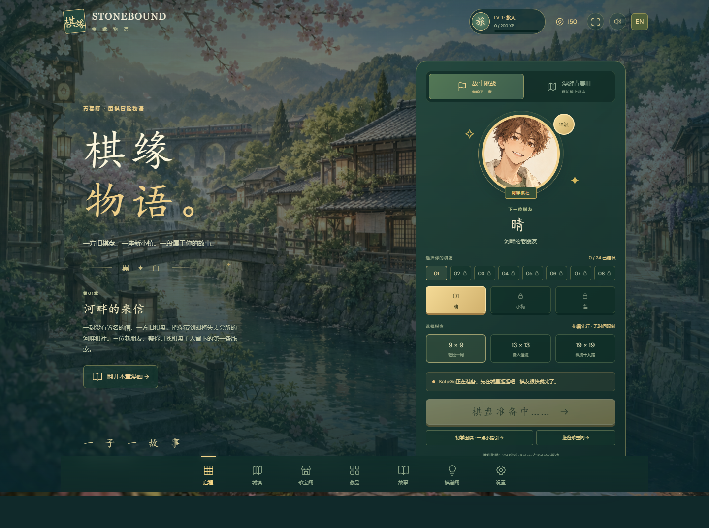
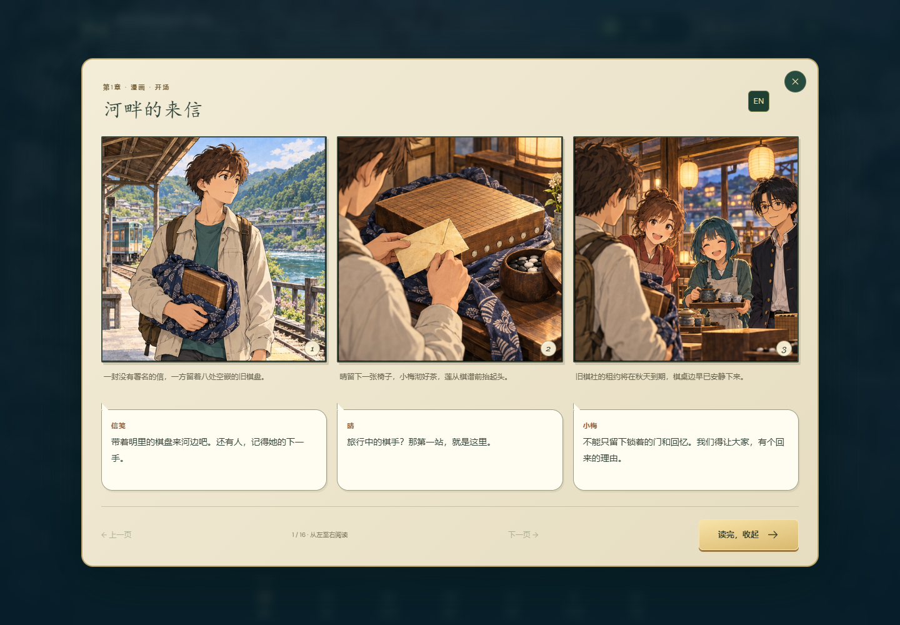

# Stonebound · 棋缘物语

A story-driven Go adventure built around the **actual KaTrain / KataGo AI core**. Explore Aoharu, meet 24 original rivals across eight districts, and turn victories into new boards and stone sets.

**[Download Windows portable ZIP](https://github.com/chon9/stonebound/releases/latest/download/Stonebound-Windows-x64.zip)** · [Standalone EXE](https://github.com/chon9/stonebound/releases/latest/download/Stonebound.exe) · [All releases](https://github.com/chon9/stonebound/releases)

原创动漫风围棋冒险：24位棋友、48件藏品、8章故事与48格漫画。使用真实KaTrain／KataGo AI，支持英文与简体中文。下载Windows便携版，解压后双击即可游玩。





## Portable Windows game

Download **[Stonebound-Windows-x64.zip](https://github.com/chon9/stonebound/releases/latest/download/Stonebound-Windows-x64.zip)** from GitHub Releases, extract it into a writable folder, and double-click **`Stonebound.exe`**. The local build is also available at `release/Stonebound.exe`. No Python, Git, Node, terminal, or setup commands are required on the playing computer.

The executable opens a dedicated desktop window. It embeds the Python runtime, unmodified pinned KaTrain core, KataGo, its neural-network model, original artwork, fonts, and both languages. It defaults to the generic x64 **CPU** version of KataGo, which works without a dedicated GPU or OpenCL driver. CPU turns can take longer than GPU turns.

Requires **Windows 10/11 x64 and Microsoft Edge WebView2**. WebView2 is already present on most current Windows installations; if missing, install Microsoft's [WebView2 Evergreen Runtime](https://developer.microsoft.com/microsoft-edge/webview2/) once. The executable is unsigned. The first run needs a few seconds to unpack and load the model.

Everything writable stays in **`data/` beside the EXE**, including `save.json`, engine caches, and WebView2 state. Copy the EXE and its `data` folder together to move your game. Keep the game in a writable location such as a personal folder or USB drive. Only one desktop instance can open a given save directory at a time.

To migrate a source-version save, close both versions, back up the destination, and copy `.runtime/save.json` to `data/save.json` beside the EXE. Old saves retain coins, equipment, victories and preferences. Already completed chapters receive their new keepsakes automatically, without changing equipped items. Previously defeated rivals remain available for rematches.

See `PORTABLE-README.txt` for bilingual portable instructions. Startup diagnostics are written to `data/desktop.log`.

## The game interface

The redesign references the full-screen lobby and game navigation of [Little Kingdoms](https://3k.chon9.com/): an illustrated world backdrop, dark jade panels, gold frames and buttons, rival portrait stage, player HUD, and bottom navigation dock. Stonebound retains its own original setting, characters, graphics and Go gameplay.

- **Adventure:** select a rival and board size; start their story or resume your current match.
- **Travel:** explore the illustrated town through location markers and character encounters.
- **Treasury:** buy board and stone designs with earned coins. Story victories unlock stock.
- **Wardrobe:** preview and equip owned boards and stones.
- **Chronicle:** eight story chapters, 16 bilingual manga pages (48 illustrated panels), completed-game memories, XP and victories.
- **Codex:** concise Go rules covering liberties, captures, territory, passes, hints and ko.
- **Settings:** persistent language and sound preferences; engine status and failure details.

The match screen presents the Go board with framed rival art, player indicators, a move counter, captured-stone counts, and concise controls. There are no analysis graphs or training tools in the play flow.

## The illustrated campaign

An unsigned letter brings the traveler and their grandmother Akari’s board to a riverside club that may lose its home. Follow an unfinished exhibition record through the station quarter, lantern market, harbor, misty foothills, city qualifiers and regional cup, then return to reopen the club. Each chapter has three rivals with their own conversations, an opening manga page and a conclusion page unlocked by three victories.

Read the panels left to right. Dialogue and narration are live text, so the reader can switch language without replacing the art. Read state is saved. Replay unlocked pages in Chronicle; locked conclusions contain no script text in the state response. Original art briefs are recorded in `content/art-prompts.json`.

Boards and stones use shared canvas materials in the treasury and actual matches, including porcelain, ripples, garden leaves, star charts, circuit lines, marble, kintsugi, veins, speckles, metallic bands and seals.

## English and Chinese

Use the top-right **简 / EN** button, or choose **English / 简体中文** in Settings. The interface, story dialogue, rival names, locations, cosmetic items, instructions, common gameplay errors and results are translated. Language and sound are saved in the player profile, so changing the native window's local port or moving the portable game does not reset them. Language can be changed during a match without changing the board.

## Game rules and progression

Play black against 24 increasingly strong KaTrain rivals (15 kyu through a configured 4 dan target) on **9×9, 13×13 or 19×19** boards. Captures, suicide prevention and ko use upstream KaTrain rules. Undo reverses your last move and the AI reply; hints come from KataGo analysis. No time limit.

Two consecutive passes end a game. **Chinese area scoring** counts live stones and enclosed empty points, with **6.5 komi** for white. KataGo ownership identifies confidently dead stones; uncertain groups count as alive. **Play out unsettled groups before passing.** There is no manual dead-stone adjudication screen yet.

First wins earn 250–1,405 coins and unlock the next rival. Repeat wins earn 80 coins. Losses award 25 XP. Rewards and purchases are validated and saved by the backend; browser-provided scores do not award wins. Collect 24 boards and 24 stone sets: 40 shop catalog entries (including the two starting items) and eight chapter-completion keepsakes. Keepsakes require beating all three rivals in their chapter; they cannot be purchased. This is a local single-player game with no accounts, payments, or multiplayer.

## Actual KaTrain AI integration

Unmodified KaTrain source is checked out at `vendor/katrain`, pinned to:

```text
https://github.com/sanderland/katrain
f4981cf905cece90085ce4e3967415d0c16d525f
```

`stonebound/engine.py` imports upstream `KataGoEngine`, `Game`, `GameNode`, and `generate_ai_move`. Rivals use upstream `AI_RANK` with distinct `kyu_rank` settings. There is no substitute JavaScript bot. Visible engine errors preserve the position with retry/undo actions. Configured ranks are strength targets, not guaranteed human ratings on every board size.

The source checkout uses KaTrain's bundled OpenCL KataGo executable and `b10c384h6nbttflrs.bin.gz` model. The portable build adds the official generic x64 Eigen CPU executable from KataGo v1.18.1, verified against its published SHA-256. It uses the same KaTrain neural-network model and strategy.

To use an existing GPU KataGo installation, place `engine-config.json` beside the EXE (or in the project root for source mode) using `engine-config.example.json` as a guide. Set absolute `katago`, `model` and `config` paths. `KATAGO_EXECUTABLE`, `KATAGO_MODEL`, and `KATAGO_CONFIG` environment variables also work. JSON accepts KaTrain's `max_visits`, `fast_visits` and `max_time`. Restart after changing engine configuration.

## Run from source

The existing `Start-Stonebound.cmd` browser launcher still works. First-time source setup needs Git plus uv or Python 3.12:

```powershell
powershell -NoProfile -ExecutionPolicy Bypass -File scripts/setup.ps1
.venv/Scripts/python.exe server.py --open
```

For a native window from source, install the optional desktop/build dependencies, then run:

```powershell
uv pip install --python .venv/Scripts/python.exe -r requirements-build.txt
.venv/Scripts/python.exe desktop.py
```

Python 3.11–3.13 is required by upstream KaTrain/pysgf; setup uses 3.12. Source saves remain in `.runtime/`. `STONEBOUND_DATA_DIR` or the desktop `--data-dir` option selects an alternate save directory. No JavaScript build is required.

## Rebuild the portable EXE

```powershell
powershell -NoProfile -ExecutionPolicy Bypass -File scripts/build-windows.ps1
```

The script installs pinned packaging dependencies, fetches and verifies CPU KataGo, builds the single-file Windows application from `Stonebound.spec`, and creates the portable ZIP with instructions and notices. Build artifacts go to `.build/` and `release/`. The packaging hook collects Kivy's event/config/storage primitives needed by KaTrain, keeping its analysis UI and media providers out of the executable.

## Verify

```powershell
.venv/Scripts/python.exe -m unittest discover -s tests -v
node --check web/app.js
.venv/Scripts/python.exe tests/integration.py
```

Browser checks use optional Playwright (`npm install`; install Chromium if needed). Use a separate save because tests play and resign actual games:

```powershell
# Terminal 1
$env:STONEBOUND_DATA_DIR = "$PWD/.runtime/browser-test"
.venv/Scripts/python.exe server.py --port 8766
# Terminal 2
npm run test:browser
```

The browser suite checks both languages, dialogue/items/rules, reload persistence, actual AI replies, hints, undo, keyboard play, saved results, mobile layouts and the absence of external runtime requests. The integration suite plays a complete real-engine game, checks victory rewards and purchases, then verifies backend restart with an active match.

The full-campaign visual suite uses an explicitly seeded test fixture, separate from actual-game verification:

```powershell
# Terminal 1
.venv/Scripts/python.exe tests/campaign_fixture.py
# Terminal 2
node tests/campaign-browser.mjs
.venv/Scripts/python.exe tests/expanded-ai.py
```

The fixture checks all portraits, 16 manga pages, bilingual reader navigation and read persistence, 48 material previews, keepsakes and mobile layouts. `expanded-ai.py` verifies actual KaTrain turns for new intermediate and final dan targets on 13×13 and 19×19.

The EXE also supports isolated package verification without installing Python:

```powershell
release/Stonebound.exe --self-test engine-report.json --data-dir .runtime/package-test
release/Stonebound.exe --window-test window-report.json --data-dir .runtime/window-test
```

`--self-test` requires a fresh test save. It initializes the embedded CPU engine and plays a real AI turn. `--window-test` opens a hidden native window, checks that the lobby rendered, writes a JSON report and closes. These modes are for development; normal play needs no command line.

Verified for this release: 22 rule/scoring/progression/preference/campaign tests; bilingual browser gameplay and mobile layouts; native WebView2 rendering; and a relocated EXE running from a folder containing spaces and Chinese characters, with Python removed from PATH. The relocated build produced an actual KataGo reply and reopened with its saved Chinese preference. File size, SHA-256 and test reports are recorded in `release/BUILD-INFO.json`.

Original generated artwork and prompts are recorded in [ASSETS.md](ASSETS.md). Upstream notices and bundled-font licenses are listed in [THIRD_PARTY_NOTICES.md](THIRD_PARTY_NOTICES.md).
